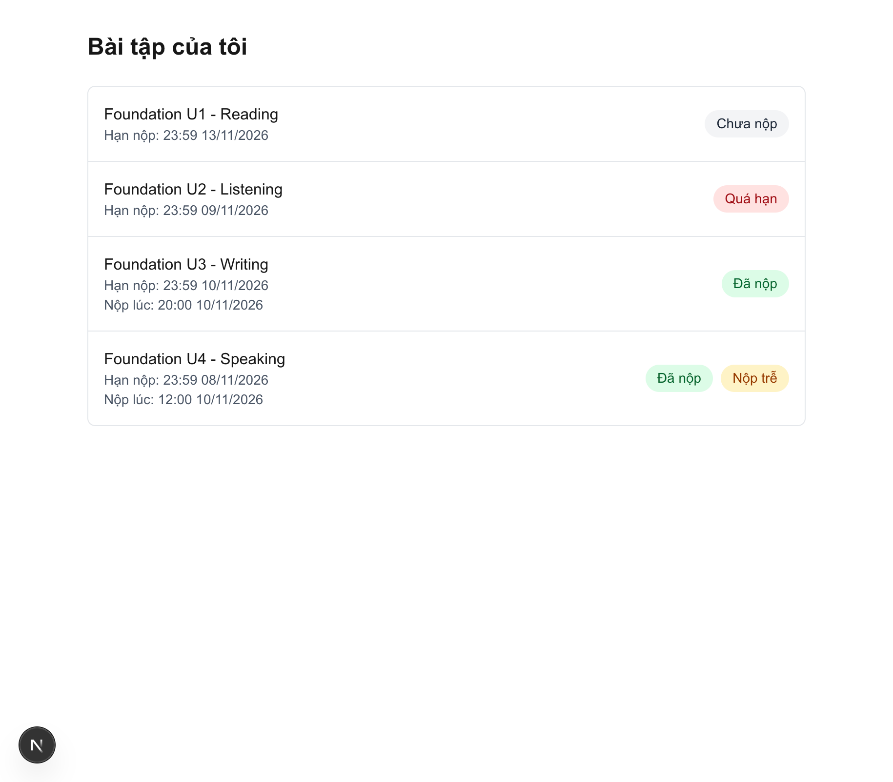
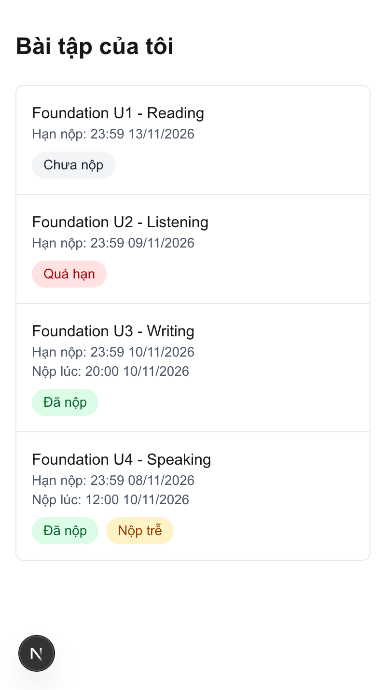

# Bài tập của tôi — IELTS Master (bài test Junior Full-Stack)

Trang "Bài tập của tôi" cho học viên giả lập **S01**: hiển thị tên bài, hạn nộp, trạng thái
(Chưa nộp / Quá hạn / Đã nộp / Nộp trễ). Dữ liệu mock, "bây giờ" cố định **11/11/2026 09:00 (GMT+7)**.





## Công nghệ

Next.js 16 (App Router, Route Handler) · React 19 · TypeScript · Tailwind CSS 4 · Vitest 4

## Cách chạy

Yêu cầu: Node.js ≥ 20.9

```bash
npm install
npm run dev
```

Mở http://localhost:3000 (tự chuyển sang `/my-assignments`).

Thử các trạng thái giao diện:

| URL | Kết quả |
|---|---|
| `/my-assignments` | Danh sách 4 bài của S01 |
| `/my-assignments?simulate=error` | Trạng thái lỗi |
| `/my-assignments?simulate=empty` | Trạng thái rỗng |
| `/api/my-assignments?studentId=S02` | JSON vẫn chỉ có A01–A04 (tham số bị bỏ qua) |

API: `GET /api/my-assignments`

## Cách test

```bash
npm test           # 17 test
npm run test:tz    # chạy lại dưới múi giờ Tokyo và New York (macOS/Linux)
```

Kết quả:

```
 ✓ src/server/assignment-status.test.ts (11 tests)
 ✓ src/app/api/my-assignments/route.test.ts (6 tests)

 Test Files  2 passed (2)
      Tests  17 passed (17)
```

- **Hàm trạng thái** (11 test): 4 ca của đề, ca biên quanh hạn 23:59 (23:59:59 / 00:00:00), giờ nộp so với "now".
- **API** (6 test): chỉ trả A01–A04, không có B01; bỏ qua `?studentId=S02`; không trả `studentId`; trạng thái đúng; lỗi/rỗng giả lập.

## Chặn lộ dữ liệu S02

- Danh tính lấy từ **session giả lập ở server** (`src/server/session.ts`), không bao giờ từ URL, query hay body.
  URL không chứa studentId (`/my-assignments`, `/api/my-assignments`), nên `?studentId=S02` bị bỏ qua.
- **Lọc ở server** trong Route Handler: dữ liệu S02 không bao giờ được gửi xuống trình duyệt
  (không lọc ở client).
- API chỉ trả các field UI cần (không trả `studentId`).
- Trang **không import file data** — chỉ gọi API.
- Có test chứng minh: `route.test.ts`.

Đây là cách phòng lỗi IDOR / Broken Access Control (OWASP Top 10 #1).

## Cấu trúc

```
src/
├── server/                     # chỉ chạy ở server
│   ├── assignments.ts          # kiểu Assignment + dữ liệu mock
│   ├── assignment-status.ts    # hàm thuần tính trạng thái (nhận now làm tham số)
│   ├── session.ts              # session giả lập: luôn S01
│   └── clock.ts                # "bây giờ" cố định — định nghĩa ở MỘT chỗ
└── app/
    ├── api/my-assignments/route.ts   # GET: session → lọc → tính trạng thái → JSON
    └── my-assignments/page.tsx       # trang: gọi API, loading / lỗi / rỗng, responsive
```

## Quy ước & quyết định

- **Thời gian**: mọi mốc lưu dạng ISO 8601 có `+07:00`; so sánh bằng epoch (`getTime()`) nên không
  phụ thuộc múi giờ máy chủ. UI luôn hiển thị giờ Việt Nam (`Asia/Ho_Chi_Minh`).
- **"Bây giờ"**: không dùng giờ thật. Cố định trong `src/server/clock.ts`; hàm trạng thái nhận
  `now` làm tham số nên test truyền mốc tuỳ ý.
- **Hạn 23:59**: tính trọn phút — đúng hạn nếu trước 00:00:00 hôm sau. Quá hạn cũng theo mốc này.
- **Thứ tự kiểm tra**: đã nộp? → so giờ nộp với hạn (Nộp trễ hay không); chưa nộp → so now với hạn.
- **"Nộp trễ"** chỉ đi kèm "Đã nộp", không bao giờ kèm "Quá hạn".
- **Nộp sau "now"**: trạng thái là "tại thời điểm now", nên bài nộp sau now được coi là chưa nộp.
- **Mã trạng thái** (`submitted` / `overdue` / `not_submitted`) ở logic; nhãn tiếng Việt ở UI.

## Chưa làm / hướng mở rộng

- Đăng nhập thật (cookie/JWT) — chỉ cần thay ruột `getCurrentSession()`.
- `import "server-only"` cho các file trong `src/server/` (cần cấu hình thêm cho Vitest).
- Nộp lại nhiều lần (lấy lần nộp gần nhất ≤ now).
- Test giao diện (Testing Library / Playwright).
- Kiểm tra định dạng ngày khi dữ liệu đến từ nguồn ngoài (vd zod) — hiện ngày sai định dạng không báo lỗi mà cho ra trạng thái sai.
- Tắt `?simulate=` khi chạy production.
- Icon (i) hiện giờ giả lập; nút "Thử lại" khi lỗi; sắp xếp/lọc theo trạng thái.

## Sử dụng AI

Tôi dùng Claude (Claude Code) trong quá trình làm bài: AI gợi ý code mẫu kèm giải thích cho
các bước, tôi gõ lại, chạy thử và chỉnh sửa; AI cũng review và chỉ ra lỗi sau mỗi bước.
Các quyết định chính (danh tính lấy từ session ở server, "now" cố định ở một chỗ, quy tắc
hạn 23:59) tôi phân tích và chốt trước khi bắt đầu làm bài; riêng phần xử lý bài nộp sau "now" tôi chốt khi viết hàm trạng thái.
Tôi hiểu và giải thích được từng phần của bài.